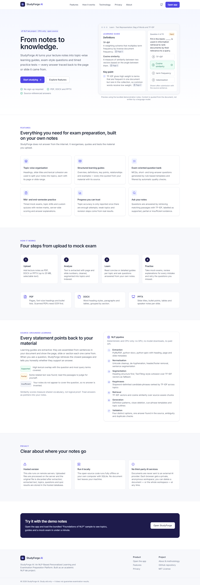
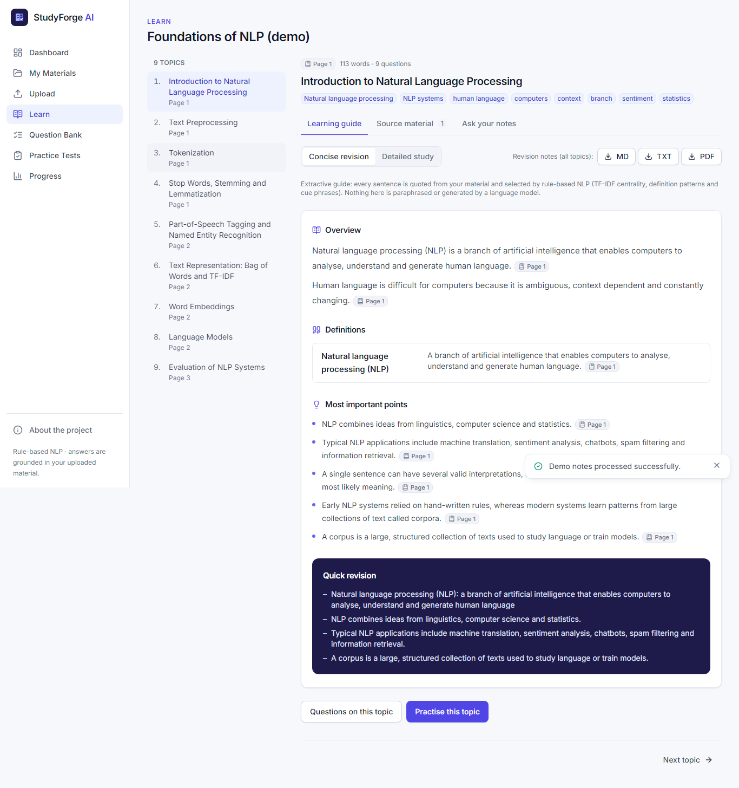
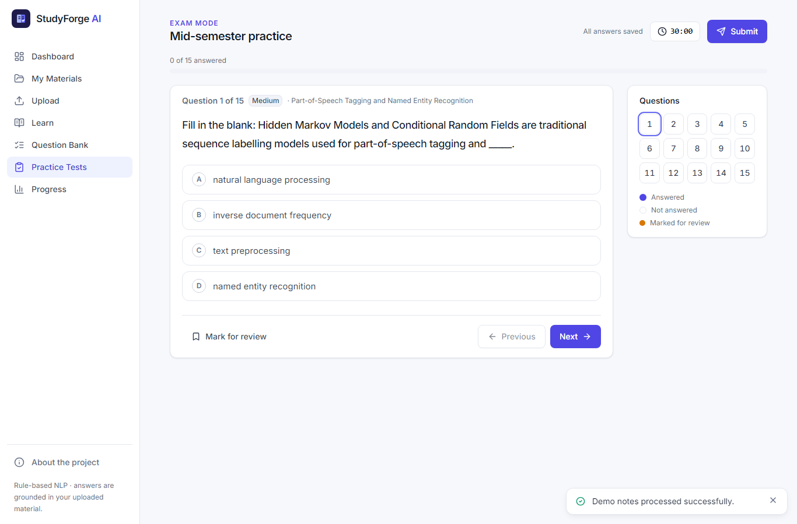
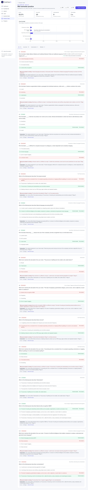
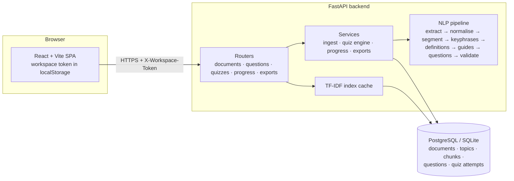

# StudyForge AI

**From Notes to Knowledge.**

*StudyForge AI: An NLP-Based Personalized Learning and Examination Preparation Platform*

StudyForge AI is a document-grounded study platform for college students. Upload lecture notes as **PDF, DOCX or PPTX**; StudyForge extracts the text with page and slide numbers, organises it into topics, builds extractive learning guides, generates and validates exam-style questions, runs timed mid- and end-semester practice tests, explains every mistake and tracks accuracy by topic.

Everything runs on a CPU with classical, rule-based NLP (TF-IDF, cosine similarity, lexical patterns). No GPU, no model download and no paid API are required.

<!-- LIVE-LINKS -->
- **Live app:** _deployment pending_
- **API health:** _deployment pending_
<!-- /LIVE-LINKS -->

---

## Contents

- [Problem statement](#problem-statement)
- [Features](#features)
- [Screenshots](#screenshots)
- [Architecture](#architecture)
- [Technology stack](#technology-stack)
- [Getting started](#getting-started)
- [Environment variables](#environment-variables)
- [API](#api)
- [NLP methodology](#nlp-methodology)
- [Testing](#testing)
- [Deployment (Render)](#deployment-render)
- [Privacy](#privacy)
- [Known limitations](#known-limitations)
- [Troubleshooting](#troubleshooting)
- [Future scope](#future-scope)
- [Project documents](#project-documents)
- [License](#license)

## Problem statement

Before exams, students have large amounts of unstructured material — slides, handouts and notes — and little time to organise it. General-purpose chatbots answer from general knowledge rather than from the syllabus actually taught, and can state wrong information confidently. Students need revision material and practice questions that come from, and can be traced back to, their own course content.

## Features

| Area | What it does |
| --- | --- |
| **Ingestion** | PDF (PyMuPDF), DOCX (python-docx) and PPTX (python-pptx) with headings, paragraphs, tables, speaker notes and page/section/slide numbers. Detects scanned PDFs, corrupted files, encrypted PDFs and documents with too little text. 25 MB limit (configurable). Duplicate uploads are recognised and not re-processed. |
| **Topics** | Heading- and slide-based segmentation, with a TextTiling-style fallback for documents without headings. Each topic keeps its page/slide range and keyphrases. |
| **Learning guides** | Overview, definitions, key points, main concepts, relationships, examples and a quick-revision list — every line quoted from the source with its location. Concise and detailed modes. |
| **Ask your notes** | TF-IDF + cosine-similarity retrieval over source-aware chunks; answers are labelled *supported*, *partial* or *insufficient evidence*. |
| **Question bank** | MCQs, short-answer and long-answer questions across definition, factual, conceptual, application and revision categories, with difficulty, explanation and source reference. Filter, browse, generate random sets and download (Markdown, TXT, PDF; with or without answer key). |
| **Practice tests** | Mid-semester (first half of topics), end-semester (all topics), topic and custom quizzes. One question at a time, question navigator, mark for review, optional timer with auto-submit, autosave, submit confirmation. Answers never leave the server before submission. |
| **Scoring and review** | Server-side scoring against stored answer keys, duplicate-submission protection, per-topic breakdown, explanations of wrong options and one-click retry of missed questions. |
| **Progress** | Quiz history, score trend, accuracy by topic (only after ≥5 attempted questions), weak topics, incorrect-question review that clears once you answer correctly, and revision recommendations. |
| **Exports** | Revision notes, question banks and quiz results as Markdown, TXT or PDF. |
| **Optional LLM** | Adapter for a local Ollama server, disabled by default and clearly labelled when used. |

## Screenshots

Screenshots in [`docs/screenshots/`](docs/screenshots/) were captured by the Playwright end-to-end script (`scripts/e2e_smoke.py`) running the real application with the bundled demo notes.

| Landing | Learning guide | Practice test | Results |
| --- | --- | --- | --- |
|  |  |  |  |

To recapture: start the app locally (below), then run `python scripts/e2e_smoke.py http://localhost:4173 docs/screenshots`.

## Architecture



- The **upload request** runs the whole pipeline synchronously (typically under a second for lecture-sized documents; hard timeout 120 s) and stores the results in one transaction. The original file is discarded.
- **Quiz answers are scored on the server**; the exam view of a quiz never includes answer keys.
- **Isolation:** every browser receives an anonymous workspace token (256-bit random). Only its SHA-256 hash is stored, and every document, question, quiz and progress query is filtered by the owning workspace.

See [docs/SYSTEM_ARCHITECTURE.md](docs/SYSTEM_ARCHITECTURE.md) for the data model and request flows.

### Repository layout

```
studyforge-ai/
├── backend/
│   ├── app/
│   │   ├── api/          FastAPI routers and dependencies
│   │   ├── core/         errors, rate limiter, token hashing
│   │   ├── db/           engine and sessions
│   │   ├── models/       SQLAlchemy models
│   │   ├── schemas/      Pydantic request/response models
│   │   ├── services/     ingestion, quizzes, progress, exports
│   │   ├── nlp/          extraction, text, segmentation, keywords, guide, questions, retrieval, llm
│   │   ├── sample_data/  synthetic demo notes
│   │   └── utils/        PDF/DOCX/PPTX builders for samples and tests
│   ├── tests/            pytest suite
│   └── requirements*.txt
├── frontend/             React + TypeScript + Tailwind SPA (Vitest tests in src/test)
├── docs/                 report, methodology, architecture, API, viva questions, deployment
├── samples/              demo notes in PDF, DOCX and PPTX
├── scripts/              sample generator, Playwright end-to-end script
├── render.yaml           Render Blueprint
└── .github/workflows/    CI
```

## Technology stack

- **Frontend:** React 18, TypeScript, Vite 5, Tailwind CSS 3, React Router, Lucide icons, Recharts, self-hosted Inter font
- **Backend:** Python 3.11, FastAPI, Uvicorn, Pydantic v2, SQLAlchemy 2, SQLite (dev) / PostgreSQL via psycopg 3 (prod)
- **NLP:** PyMuPDF, python-docx, python-pptx, scikit-learn, NumPy — rule-based, no model downloads
- **Quality:** pytest, Ruff, Vitest, React Testing Library, ESLint, Playwright (end-to-end script)
- **Delivery:** GitHub Actions CI, Render (static site + web service + PostgreSQL)

spaCy was considered but not used: its useful pipelines require downloading a model, which conflicts with the "no mandatory model download, small CPU instance" constraint. Sentence segmentation and phrase extraction are implemented with rules instead.

## Getting started

Requirements: Python 3.11, Node.js 20+.

```bash
git clone https://github.com/nimitSharma-03/studyforge-ai.git
cd studyforge-ai

# Backend
cd backend
python -m venv .venv
source .venv/bin/activate            # Windows: .venv\Scripts\activate
pip install -r requirements-dev.txt
uvicorn app.main:app --reload --port 8000
# API docs: http://127.0.0.1:8000/docs

# Frontend (second terminal)
cd frontend
npm ci
npm run dev                          # http://localhost:5173 (proxies /api to :8000)
```

The SQLite database is created automatically at `backend/data/studyforge.db`. Click **Try the demo notes** in the app to load the synthetic sample, or upload a file from [`samples/`](samples/).

Production-style local run: `npm run build && npx vite preview` (port 4173, also proxies `/api`).

## Environment variables

Copy [`.env.example`](.env.example) to `backend/.env`. All values have safe defaults for local development.

| Variable | Default | Purpose |
| --- | --- | --- |
| `APP_ENV` | `development` | `production` disables API docs unless `ENABLE_DOCS=true` |
| `DATABASE_URL` | SQLite in `backend/data/` | `postgres://` / `postgresql://` URLs are converted to the psycopg driver automatically |
| `ALLOWED_ORIGINS` | `http://localhost:5173,…` | Comma-separated CORS origins |
| `MAX_UPLOAD_MB` | `25` | Upload size limit |
| `MAX_PAGES` | `400` | Page/slide limit per document |
| `MAX_DOCUMENTS_PER_WORKSPACE` | `15` | Storage quota per workspace |
| `PROCESSING_TIMEOUT_SECONDS` | `120` | Pipeline deadline |
| `UPLOADS_PER_HOUR`, `QUIZZES_PER_HOUR`, `WORKSPACES_PER_HOUR_PER_IP` | `20`, `120`, `30` | Rate limits |
| `ENABLE_DOCS` | unset | Force `/docs` on or off |
| `OLLAMA_URL`, `OLLAMA_MODEL`, `OLLAMA_TIMEOUT_SECONDS` | empty, `llama3.2`, `60` | Optional local LLM; empty URL disables it |
| `VITE_API_BASE_URL` (frontend, build time) | empty | Backend origin for production builds |

No upload or export directory is configured because nothing is written to disk: uploads are parsed in memory and exports are generated per request.

## API

Interactive documentation is served at `/docs` (Swagger UI) and `/redoc`. All endpoints are under `/api`; all except `/health` and `POST /workspaces` require the `X-Workspace-Token` header. Errors are JSON: `{"detail": "...", "code": "..."}`.

| Method & path | Purpose |
| --- | --- |
| `GET /api/health` | Health check (used by Render) |
| `POST /api/workspaces` · `GET/DELETE /api/workspaces/me` | Create anonymous workspace, info, delete all data |
| `POST /api/documents` · `POST /api/documents/sample` | Upload and process a file · load demo notes |
| `GET /api/documents` · `GET/PATCH/DELETE /api/documents/{id}` | List, details, rename, delete |
| `GET /api/documents/{id}/delete-impact` | What a deletion will remove |
| `GET /api/documents/{id}/content` · `/topics` | Extracted passages (paginated) · topics |
| `GET /api/topics/{id}` | Topic with learning guide and source passages |
| `POST /api/documents/{id}/ask` | Source-grounded question answering |
| `POST /api/topics/{id}/llm-explanation` | Optional Ollama explanation (503 when disabled) |
| `GET /api/questions` · `POST /api/questions/generate` | Question bank (filters, pagination) · random question set |
| `POST /api/quizzes` · `GET /api/quizzes` | Create quiz · history |
| `GET /api/quizzes/{id}` · `PUT …/responses` · `POST …/submit` · `GET …/result` · `POST …/retry` · `DELETE` | Exam view, autosave, submit, result, retry incorrect, discard |
| `GET /api/progress/summary` · `GET /api/progress/incorrect` | Progress analytics · incorrect-question review |
| `GET /api/exports/documents/{id}/notes` · `…/questions` · `GET /api/exports/quizzes/{id}` | Markdown / TXT / PDF downloads |

Full reference: [docs/API_REFERENCE.md](docs/API_REFERENCE.md).

## NLP methodology

1. **Extraction** — PDF spans with font sizes (headings = larger or bold short lines), DOCX heading styles and tables, PPTX titles/bullets/tables/notes. Page/section/slide numbers stay attached to every block. Repeated short running headers and page numbers are removed; image-only PDFs are reported as scanned.
2. **Normalisation** — Unicode NFKC, quote/bullet cleanup, de-hyphenation across line breaks (keeping real compounds), sentence segmentation aware of abbreviations.
3. **Topic segmentation** — the deepest heading level giving ≤ 40 sections; tiny sections merged; "(cont.)" slides joined. Without headings: TextTiling-style cuts at valleys of TF-IDF cosine similarity between adjacent paragraph windows.
4. **Chunking** — ~160-word passages that never cross topic boundaries and keep page ranges.
5. **Keyphrases** — runs of content words between stopwords/punctuation/common verbs, ranked by TF-IDF across topics, boosted for headings and defined terms.
6. **Definitions** — lexical patterns (`X is defined as`, `X refers to`, `X is the process of`, `X: Y`, constrained `X is a Y`).
7. **Learning guides** — TF-IDF degree centrality + keyphrase coverage + position, maximal marginal relevance for diversity, cue phrases for relationships and examples.
8. **Retrieval & QA** — TF-IDF (light stemming, uni+bigrams) with cosine similarity; verdict from top sentence similarity and query-term coverage.
9. **Question generation** — definition MCQs in both directions, cloze deletion of key concepts, "such as" example MCQs, pattern-based short answers, compare-and-contrast and outline long answers.
10. **Validation** — four distinct options, verified answer mapping, answer present in the source sentence, no option leaked in the stem, balanced option length, distractors not sharing word roots with the answer or defined in terms of it, a completion probe against the source, duplicate and near-duplicate removal. Rejections are counted per reason and shown to the user.

Details and worked examples: [docs/NLP_METHODOLOGY.md](docs/NLP_METHODOLOGY.md).

## Testing

```bash
cd backend && pytest -q && ruff check . && ruff format --check .
cd frontend && npm test && npm run lint && npm run typecheck && npm run build
python scripts/e2e_smoke.py http://localhost:4173     # with backend + vite preview running
```

- **Backend (pytest):** extraction for all three formats, invalid/corrupted/empty/scanned files, header removal, normalisation, segmentation (headings and TextTiling), chunk boundaries, keyphrases, definitions, guides, MCQ structure and validation rules, retrieval and QA verdicts, upload limits and quotas, rate limiting, duplicate uploads, cross-workspace access denial, cascade deletion, question bank filters, exports, quiz answer hiding, server-side scoring, unanswered handling, client score injection, duplicate and concurrent submission, autosave, mid-semester topic coverage, retry, progress thresholds and incorrect-question resolution.
- **Frontend (Vitest + RTL):** landing page, navigation, dashboard empty state and metrics, backend-unavailable state, materials listing and deletion, upload validation and errors, topic switching, quiz interaction and submission payload, results display, API client token handling and error mapping.
- **End-to-end (Playwright):** the full upload-to-results workflow in Chromium.

CI runs the backend and frontend suites on every push and pull request.

## Deployment (Render)

The repository includes a [Render Blueprint](render.yaml) with three resources:

| Resource | Type | Notes |
| --- | --- | --- |
| `studyforge-db` | PostgreSQL (free) | Durable storage for all application data |
| `studyforge-api` | Python web service | `rootDir: backend`, health check `/api/health`, `DATABASE_URL` from the database |
| `studyforge-web` | Static site | `rootDir: frontend`, `VITE_API_BASE_URL` set to the API URL, SPA rewrite to `index.html` |

Deploy with **New → Blueprint** in the Render dashboard and select this repository, or create the three services manually with the same settings. Step-by-step instructions, including what to change for different service URLs: [docs/DEPLOYMENT_GUIDE.md](docs/DEPLOYMENT_GUIDE.md).

Hosting notes (free tier): the API sleeps after ~15 minutes without traffic and takes up to about a minute to wake (the frontend shows a "connecting" notice and retries); Render's free PostgreSQL instances expire after a limited period unless upgraded; the filesystem is ephemeral, which is why nothing is stored on disk.

## Privacy

- **What is stored:** extracted text split into passages, topics, learning guides, generated questions, quiz attempts and answers, plus document metadata (name, size, type, hash). The **original file is not stored**.
- **Where:** in the configured database — SQLite on your machine when run locally, PostgreSQL on Render for the hosted version.
- **External services:** none by default. Documents are never sent to a third-party AI service. The optional Ollama adapter sends topic passages only to the URL you configure.
- **Deletion:** deleting a document removes its passages, topics, questions and the quiz attempts that used it. "Delete all my data" removes the whole workspace.
- **Hosted ≠ offline:** the public deployment runs on remote servers. Only a local installation keeps everything on your computer.
- **Logs** contain method, path, status and timing only — never document text or answers.

## Known limitations

- Rule-based generation works best on definitional, well-structured notes; narrative or mathematical material yields fewer questions.
- Keyphrases are heuristic (no POS tagger), so a few non-noun phrases may appear.
- Lexical similarity cannot recognise paraphrases with different vocabulary.
- No OCR; equations, images and diagrams are ignored.
- Workspaces are anonymous and tied to browser storage; there are no user accounts or cross-device sync.
- The rate limiter and TF-IDF cache are in-memory, suitable for a single instance.
- Schema changes use `create_all`; there are no migration scripts yet.
- Question quality has not been evaluated with human raters, so no accuracy figures are claimed.

## Troubleshooting

| Symptom | Fix |
| --- | --- |
| "Server unavailable" on the hosted app | The free API instance is waking up; wait up to a minute. |
| Upload fails with "scanned images" | Run OCR on the PDF (e.g. "Make searchable"), then upload again. |
| "Only N words of readable text" | The file has almost no selectable text. |
| CORS errors in the browser console | Add the frontend origin to `ALLOWED_ORIGINS` on the API and redeploy. |
| Frontend calls `localhost` in production | Set `VITE_API_BASE_URL` before building the static site. |
| Workspace data disappeared | Browser storage was cleared, or the database was reset/expired. |

## Future scope

Semantic retrieval with sentence embeddings, OCR, spaced repetition, optional accounts, teacher review of generated questions, multilingual notes and Alembic migrations.

## Project documents

- [Project report](docs/PROJECT_REPORT.md)
- [NLP methodology](docs/NLP_METHODOLOGY.md)
- [System architecture](docs/SYSTEM_ARCHITECTURE.md)
- [API reference](docs/API_REFERENCE.md)
- [Viva questions](docs/VIVA_QUESTIONS.md)
- [Deployment guide](docs/DEPLOYMENT_GUIDE.md)
- [Contributing](CONTRIBUTING.md) · [Changelog](CHANGELOG.md)

## License

[MIT](LICENSE) © 2026 Nimit Sharma
