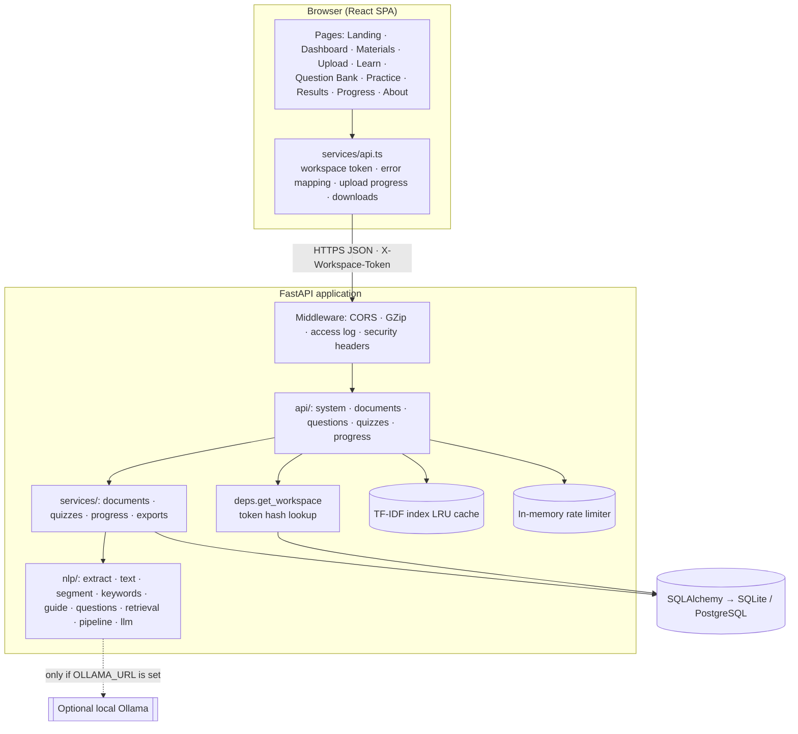
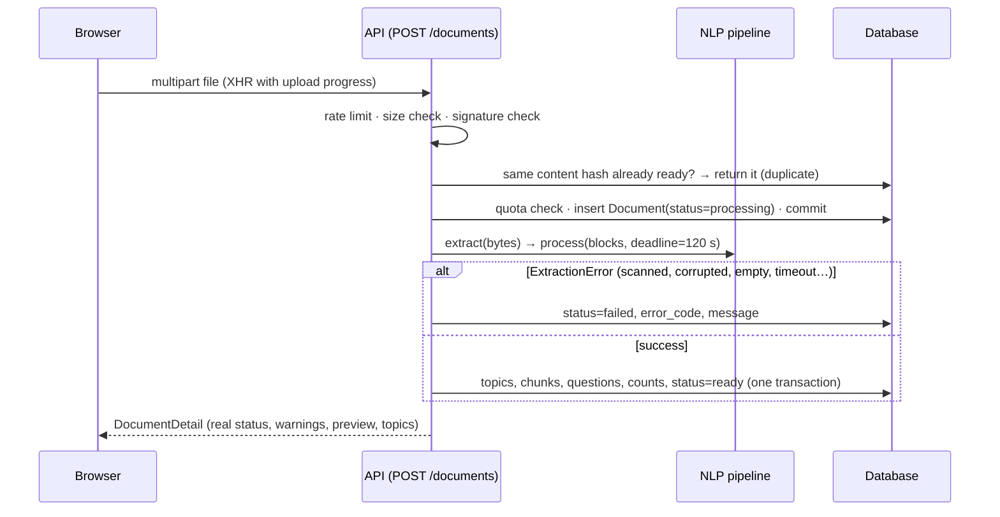
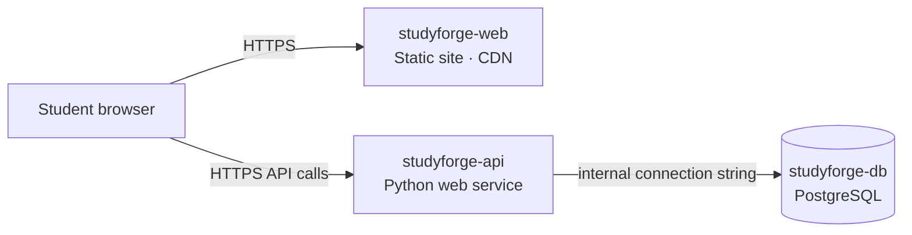

# System Architecture

## Overview



### Layers

| Layer | Responsibility | Location |
| --- | --- | --- |
| Presentation | Routing, pages, reusable components, design tokens | `frontend/src/{pages,components,layouts}` |
| Client services | Workspace token, typed API calls, upload progress, file downloads | `frontend/src/services/api.ts` |
| API | Validation (Pydantic), auth dependency, HTTP status codes, rate limits | `backend/app/api` |
| Services | Ingestion transaction, quiz engine, progress analytics, export rendering | `backend/app/services` |
| NLP | Pure functions from bytes to topics/chunks/guides/questions | `backend/app/nlp` |
| Persistence | ORM models, engine/session management | `backend/app/models`, `backend/app/db` |
| Cross-cutting | Configuration, error handlers, token hashing, rate limiter | `backend/app/config.py`, `backend/app/core` |

## Data model

```mermaid
erDiagram
  WORKSPACE ||--o{ DOCUMENT : owns
  WORKSPACE ||--o{ QUIZ_ATTEMPT : owns
  DOCUMENT ||--o{ TOPIC : has
  DOCUMENT ||--o{ CHUNK : has
  DOCUMENT ||--o{ QUESTION : has
  TOPIC ||--o{ CHUNK : groups
  TOPIC ||--o{ QUESTION : groups
  QUIZ_ATTEMPT ||--o{ QUIZ_ITEM : contains
  QUESTION ||--o{ QUIZ_ITEM : "asked in"

  WORKSPACE { string id PK; string token_hash UK; datetime created_at; datetime last_seen_at }
  DOCUMENT { string id PK; string workspace_id FK; string name; string file_type; string content_hash; string status; string error_code; int unit_count; string unit_label; int topic_count; int question_count; json warnings; json stats }
  TOPIC { int id PK; string document_id FK; int position; string title; json keywords; int location_start; int location_end; json guide }
  CHUNK { int id PK; string document_id FK; int topic_id FK; int position; text text; string heading; int location_start; int location_end }
  QUESTION { string id PK; string document_id FK; int topic_id FK; string question_type; string category; string difficulty; text stem; json options; int correct_index; json option_notes; text answer_text; text explanation; text evidence; int location_start; string stem_hash }
  QUIZ_ATTEMPT { string id PK; string workspace_id FK; string mode; string status; json document_ids; int time_limit_minutes; int total; int correct_count; int answered_count; datetime submitted_at }
  QUIZ_ITEM { int id PK; string attempt_id FK; string question_id FK; int position; int selected_index; bool is_correct; bool marked_for_review }
```

- Foreign keys use `ON DELETE CASCADE`; SQLite enforces them via `PRAGMA foreign_keys=ON`.
- Indexes: `workspaces.token_hash` (unique), every foreign key, `documents.content_hash`, `questions.stem_hash`, `(questions.document_id, question_type)`, `quiz_attempts.created_at`.
- Learning guides are stored as JSON on `topics.guide` so they are computed once at upload.
- Question and attempt IDs are random 128-bit hex strings, stable for the life of the record.
- The schema is created with `Base.metadata.create_all` on start-up (no migration tool yet).

## Key flows

### Upload and processing



Processing is synchronous: for the nine-section demo notes the pipeline takes about 0.2 s on a laptop and the whole upload request about 2–2.5 s on the free Render instance, so a background queue would add infrastructure (a worker and broker) without benefit on a single free instance. The 120-second deadline is checked between pipeline stages. The uploaded bytes live only in memory for the request.

### Quiz lifecycle

1. `POST /quizzes` selects MCQs (mode presets, topic filters, difficulty), samples them round-robin across topics, shuffles and stores `QuizItem` rows. The response contains stems and options only.
2. `PUT /quizzes/{id}/responses` autosaves selections and review marks while `status = in_progress`.
3. `POST /quizzes/{id}/submit` runs `UPDATE quiz_attempts SET status='submitted' WHERE id=? AND status='in_progress'`. Only the request that changes a row continues; any other gets **409**. Scores are computed from `questions.correct_index`; client-supplied fields other than `question_id`, `selected_index` and `marked_for_review` are ignored by the schema. Duration is measured on the server.
4. `GET /quizzes/{id}/result` returns answers, explanations, option notes, evidence and a per-topic breakdown — only for submitted attempts.

### Progress

`GET /progress/summary` joins quiz items, questions and submitted attempts for the workspace. Unanswered questions count as incorrect. Overall accuracy is reported only after 5 attempted questions; a topic is classified (weak < 60 % ≤ developing < 80 % ≤ strong) only after 5 attempted questions in that topic. The incorrect-question review uses each question's most recent answer, so a later correct answer resolves it.

## Security and isolation

| Concern | Measure |
| --- | --- |
| Identity | Anonymous workspace per browser. `POST /workspaces` returns a 256-bit random token once; only `sha256(token)` is stored. |
| Authorisation | Every document, topic, question, quiz, progress and export query is filtered by the workspace resolved from the token. Records of other workspaces return **404** (not 403) so IDs cannot be probed. |
| Exam integrity | Exam view never includes `correct_index`, explanation or evidence; scoring is server-side; atomic submit. |
| Uploads | Extension + magic-byte/ZIP-structure validation, size limit before full read, page limit, processing deadline, per-workspace quota, rate limit. Files are never written to disk or served back. |
| Exports | Generated in memory from database records; filenames are slugified; no path parameters reach the filesystem. |
| Abuse | Sliding-window limits: workspaces per IP, uploads and quizzes per workspace (in-memory; single instance). |
| Errors | Uniform JSON `{detail, code}`; unexpected errors return a reference id, details go only to logs. |
| Logging | Method, path, status and duration only. |
| Transport/browser | CORS restricted to configured origins, `X-Content-Type-Options: nosniff`, `Referrer-Policy: no-referrer`. |
| Secrets | Only via environment variables; `.env` is git-ignored; no API keys are needed. |

Limitations: no user accounts or password recovery; anyone holding a workspace token can access that workspace; rate limiting resets on restart.

## Deployment topology (Render)



The static site is served from Render's CDN and loads instantly even while the free API instance is asleep; the frontend shows a "connecting" notice and retries until the API responds.
